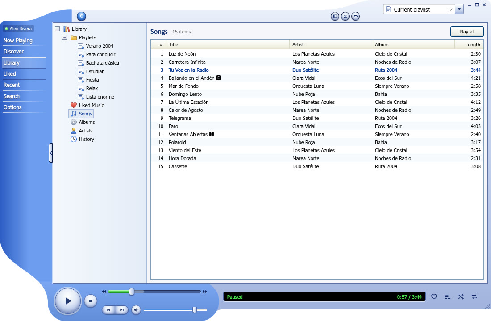
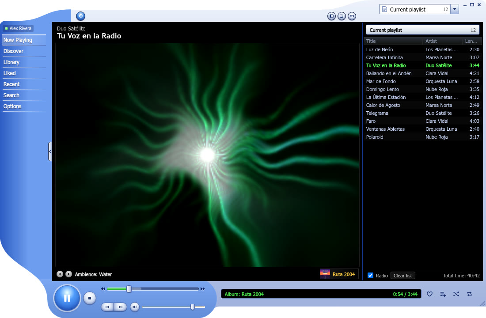

<b>English</b> · <a href="README.es.md">Español</a>

<h1>XP Music</h1>

<b>A YouTube Music desktop player that looks like Windows Media Player 9 on Windows XP.</b>

  
  
  
  
  
  

For Windows 10/11 (x64 and ARM64), with experimental support for Linux (x64 and ARM64) and macOS (Intel and Apple Silicon).

- Home, search, library, "Liked", history and radio from your YouTube Music account.
- Playlists: create them, add songs and play them.
- Visualizations that follow the beat of the music.
- Compact mode and **Windows Media Player skins** (`.wmz`).
- Media keys, tray icon, taskbar thumbnail controls and automatic updates.
- English and Spanish interface, following your system language.

> XP Music is not affiliated with, sponsored by or endorsed by Google, YouTube or Microsoft. "YouTube Music", "Windows Media Player" and "Windows XP" are trademarks of their respective owners. The app uses your own account for what you would do from the browser.

**Website:** [iznardo.github.io/xp-music](https://iznardo.github.io/xp-music/)

## Install

Download the latest version from [Releases](https://github.com/Iznardo/xp-music/releases/latest):
the `.exe` installer for Windows, the `.deb` / `.rpm` / `.AppImage` for Linux or the `.dmg` for macOS. On Arch there is a `PKGBUILD` and on NixOS a flake.
The details (SmartScreen and Gatekeeper warnings, Linux requirements, Arch, Nix, updates) are in [docs/install.md](docs/install.md).

## Documentation

- [Install](docs/install.md)
- [Usage](docs/usage.md): views, shortcuts, visualizations and options.
- [Windows Media Player skins](docs/skins.md)
- [Custom visualizations](docs/visualizations.md)
- [FAQ](docs/faq.md)
- [Building](docs/building.md)
- [Releasing](docs/releasing.md) (maintainer)

## Third-party software

- [yt-dlp](https://github.com/yt-dlp/yt-dlp) (Unlicense) and [Deno](https://deno.com) (MIT) are bundled in the release installers and packages to get the audio.
- [ytmapi-rs](https://github.com/nick42d/youtui) (MIT), with a patch, in `vendor/` (see `vendor/README.md`).
- [Tauri](https://tauri.app), [Svelte](https://svelte.dev) and the rest of the dependencies in `Cargo.toml` and `package.json`, each under its own license.

## License

[MIT](LICENSE) © 2026 iznardo.
