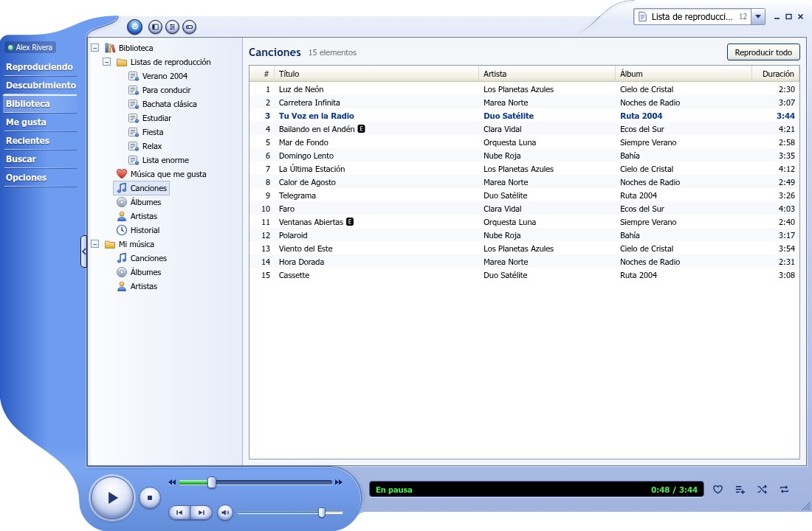
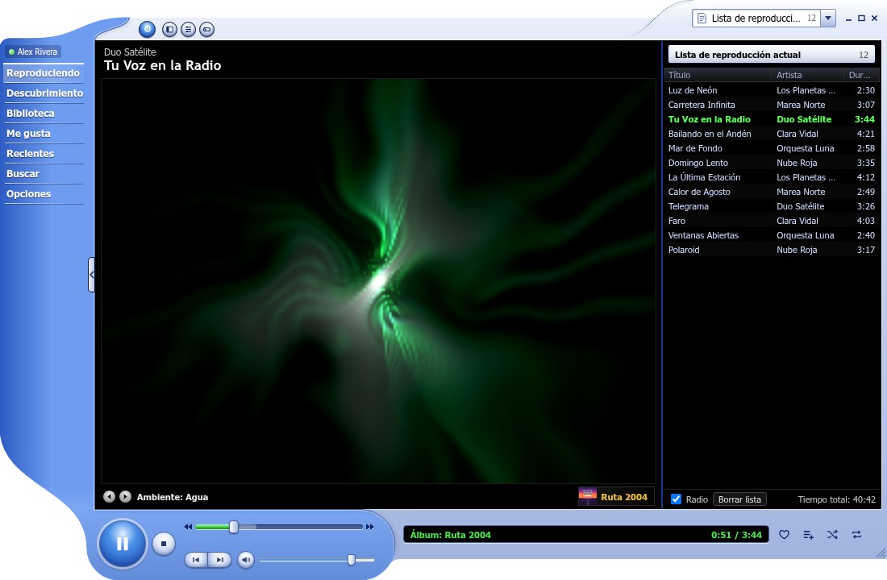

# Uso

XP Music imita a Windows Media Player 9: una barra lateral con las tareas, el contenido en el centro y los controles abajo a la izquierda.

## Vistas

| Tarea | Qué muestra |
| --- | --- |
| Reproduciendo | La visualización (o la portada) y la lista de reproducción actual. |
| Descubrimiento | El inicio de YouTube Music: recomendaciones, novedades y listas. |
| Biblioteca | Tus listas de reproducción, canciones, álbumes y artistas. |
| Me gusta | Las canciones que has marcado con «Me gusta». |
| Recientes | Tu historial de escuchas. |
| Buscar | Canciones, álbumes, artistas y listas. |
| Opciones | Tema, idioma, audio, teclado, cuenta y visualización. |

El desplegable de arriba a la derecha muestra la lista que suena y permite cambiar a otra, activar el orden aleatorio o la radio (reproducción automática al terminar la cola).

## Mi música

XP Music también reproduce la música guardada en tu equipo, con o sin cuenta de YouTube Music. En la Biblioteca, abre **Mi música** y pulsa **Agregar carpeta…** (o usa la pestaña **Mi música** de Opciones). Se incluyen las subcarpetas, y las canciones se listan por canción, álbum y artista según sus etiquetas y portadas.

Formatos admitidos: MP3, M4A/AAC (incluido ALAC), FLAC, Ogg Vorbis, WAV y AIFF. Los archivos Opus todavía no son compatibles. La biblioteca se vuelve a revisar al iniciar y cada vez que pulsas **Volver a buscar**; solo se leen de nuevo los archivos nuevos o modificados.

Las canciones locales y las de YouTube pueden compartir la misma cola. Los "Me gusta", las listas, la radio y el historial son funciones de YouTube Music, así que no están disponibles para las canciones locales.

## Atajos de teclado

| Atajo | Acción |
| --- | --- |
| Ctrl+P | Reproducir / Pausa |
| Ctrl+S | Detener |
| Ctrl+B | Anterior |
| Ctrl+F | Siguiente |
| Ctrl+H | Orden aleatorio |
| Ctrl+T | Repetir |
| F8 | Silencio |
| F9 / F10 | Bajar / subir volumen |
| Ctrl+E | Buscar |
| Ctrl+1 | Modo completo |
| Ctrl+2 | Modo compacto |

Las teclas multimedia del teclado funcionan siempre. En **Opciones → Teclado** puedes definir atajos globales que funcionan aunque XP Music esté en segundo plano.

## Visualizaciones

En «Reproduciendo», las flechas ◀ ▶ (o un clic en el escenario) cambian de visualización:

- Ambiente: Agua
- Alquimia: Plasma
- Alquimia: Espiral
- Ambiente: Pétalos
- Batería: Caleidoscopio
- Barras y ondas: Barras
- Barras y ondas: Osciloscopio
- Portada del álbum

## Modos de ventana

- **Modo completo** (Ctrl+1): la ventana normal.
- **Modo compacto** (Ctrl+2): solo los controles.
- **Modo máscara**: usa una máscara de Windows Media Player. Ver [Máscaras](skins.md).

## Opciones

En **Opciones** (o **Herramientas → Opciones…**) se configura:

- **Reproductor:** combinación de colores (Azul, Verde oliva o Plateado), apariencia clara u oscura (sigue al sistema por defecto), idioma (automático por defecto, o English / Español), cerrar a la bandeja, iniciar minimizado o al iniciar sesión, notificaciones, sonidos del sistema y pausar al bloquear el equipo.
- **Teclado:** atajos globales.
- **Audio:** dispositivo de salida, igualar el volumen entre canciones y registrar las escuchas en el historial de YouTube Music.
- **Cuenta:** la cuenta conectada; desde aquí se cierra la sesión.
- **Visualización:** la que se muestra en «Reproduciendo».
- **Acerca de:** versión, componentes (yt-dlp, Deno), actualizaciones y carpeta de registros.
